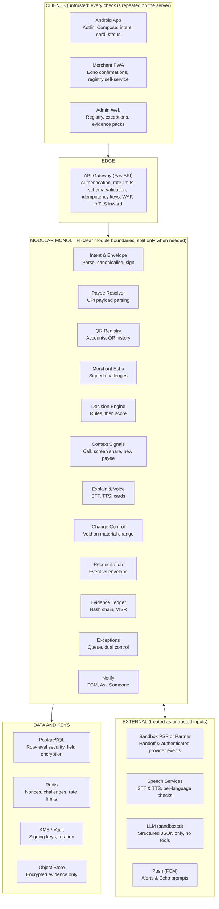

# System Architecture

A **modular monolith** keeps the system secure, testable, and demonstrable. Modules maintain clear internal boundaries and should only be split into separate services after a boundary proves it needs independent scaling or ownership.

---

## Layers and Trust Boundaries

Clients and external services are treated as **untrusted inputs**; every client check is repeated on the server.

---

## Technology Stack

| Layer | Choice | Role |
| :--- | :--- | :--- |
| **Android** | Kotlin, Jetpack Compose, Play Integrity, Keystore | Intent capture, cards, status, device binding |
| **Merchant & Admin Web** | React, TypeScript (PWA for Echo) | Echo confirmations, registry, exceptions |
| **Backend** | Python, FastAPI | APIs, rules, protocol logic |
| **Database** | PostgreSQL (UUID keys, BIGINT paise, JSONB for model results) | Intents, registry, events, receipts |
| **Cache & Queues** | Redis (nonces, challenges, rate limits, streams) | Temporary state, simple event handling; Kafka only at scale |
| **Cryptography** | SHA-256, Ed25519 (or approved scheme), cloud KMS or HSM | Hashing, signing, key rotation |
| **Speech & Language** | Sarvam or equivalent STT and TTS with per-language capability checks; structured-output LLM | Intent parsing, explanations |
| **Observability & Delivery** | OpenTelemetry, Docker, CI with SAST, DAST, and dependency scanning | Tracing, repeatable builds |

---

## Core Data Model

Core entities:

- **Identity & Consent:** `users`, `devices`, `consent_records`, `trusted_contacts` (hand-off only)
- **Merchant & Registry:** `merchants`, `merchant_payment_accounts`, `merchant_qr_records`, `merchant_devices`, `crowd_attestations`
- **Intent & Decision:** `intents`, `approvals`, `decisions`, `echo_challenges`
- **Handoff & Settlement:** `handoffs`, `provider_events`, `reconciliations`, `receipts`
- **Audit & Operations:** `ledger_events`, `exceptions`, `evidence_packs`, `audit_logs`

**Data Separation & Security Rules:**
- Keep merchant verification evidence separate from user preferences.
- Use PostgreSQL row-level security (RLS) and separate database roles per module.
- Store all monetary amounts as integer `BIGINT` paise (never floats).
- Add PostGIS only if geo-queries require it.

---

## Core Primitives

### 1. Intent Envelope (v1)
A structured, signed record of what the user stated, what was parsed, what the system checked, and what the user approved.
- Canonicalise JSON before hashing (`SHA-256`) and signing (`Ed25519` or an approved scheme).
- Approvals are single-use, expire (~5 minutes), and bind to one envelope and one consent version.
- A signature proves the envelope was not edited after signing; it does **not** prove the inputs were true—which is why every field records its source and trust level.

### 2. Decision Engine ("The LLM Talks, Rules Decide")
- The LLM only turns speech into a structured intent and turns a structured decision into plain language.
- Deterministic code compares and decides. The LLM never holds a tool, never sees payment authority, and its output is discarded unless it validates against a strict schema.
- **Outcomes:** `Allow`, `Nudge`, `Hold`, `Advise Stop`.
- **False-Warning Budget:** Every rule has an owner, an expected firing rate on legitimate test payments, and a kill threshold. Default to `Nudge` with a plain explanation; escalate to `Hold` only on high-confidence evidence.

### 3. Place-Anchored QR Registry
Answers *"does this payee belong at this place?"* using layered evidence rather than GPS alone:

| Layer | Evidence | Strength | Failure Mode & Handling |
| :--- | :--- | :--- | :--- |
| **L1** | Merchant-declared payment accounts (several allowed, including owner's personal address) | High | Merchant forgets an account: Echo resolves it. |
| **L2** | QR fingerprint history per shop | Medium | New sticker flagged, not accused. |
| **L3** | Account changes with cooling period and audit trail | High | Attacker edits a record: four-eyes approval, alerts. |
| **L4** | Crowd attestations from verified, device-bound users | Low to medium | Fake accounts: weighting and caps; deferred at scale. |
| **L5** | Location and context | Weak | Spoofing and indoor drift: never decisive. |
| **L6** | Merchant Echo confirmation | Highest | Timeout means unconfirmed, not blocked. |

**Outcome vocabulary:** `verified match`, `unconfirmed`, `mismatch`, `unregistered`. *"Unregistered"* is never labelled fraud—many genuine small shops are simply not on the registry.

### 4. Merchant Echo Protocol
A short challenge sent to the registered merchant's own device and answered by the account owner. A swapped QR cannot be confirmed by the real owner.
- Triggered conditionally (weak registry confidence, new QR fingerprint, first-time payee at this place, or amount above threshold).
- Latency target: end-to-end Echo under **5 seconds at p95** (stretch goal: 3 seconds).

### 5. Transaction Change Control
Compares the live transaction with the approved envelope before and during handoff on material fields (`payee.vpa`, `merchant_ref`, `amount_paise`, `currency`, QR payload, payment destination, transaction references). Any material change invalidates the old approval, explains the change in plain language, and requires fresh review and approval.

### 6. Settlement Reconciliation, VISR & Intent Evidence Ledger
- **Reconciliation:** Compares an authenticated provider event with the envelope field-by-field (`MATCHED`, `MISMATCH`, `UNVERIFIED`, `PARTIAL EVIDENCE`, `REVERSED / REFUNDED`).
- **Evidence Grades:**
  - `A`: Authenticated provider event (mTLS or signed callback) — used for VISR.
  - `B`: Partner-reported event without strong authentication — partial, labelled.
  - `C`: User-supplied screenshot or entered UTR — **No** (not verification).
  - `S`: Sandbox-simulated event — used for VISR, stamped `SANDBOX`.
- **Intent Evidence Ledger:** Append-only, hash-chained record linking every lifecycle event to the previous hash with a signature, trusted timestamp, key version, and field-level provenance.
