# Transaction Workflow & User Experience

## End-to-End Lifecycle (PAIL + TII)

One lifecycle, two halves—joined by the signed **Intent Envelope** created in Steps 1–4 and compared field-by-field in Step 8.

```mermaid
flowchart LR
    subgraph PAIL["BEFORE THE PIN | Pre-Authorisation Intent Layer (PAIL)"]
        S1["1. State Intent<br/>Voice or touch: payee, category, max amount"]
        S2["2. Scan & Parse<br/>UPI payload: payee address, name, amount, category code"]
        S3["3. Check<br/>Place-Anchored QR Registry & Merchant Echo"]
        S4["4. Decide<br/>Rules return Allow, Nudge, Hold, or Advise Stop"]
        S1 --> S2 --> S3 --> S4
    end

    subgraph TII["AT AND AFTER HANDOFF | Transaction Intent Integrity Protocol (TII)"]
        S5["5. Approve & Sign<br/>Envelope signed; user pays in UPI app with own PIN"]
        S6["6. Change Control<br/>Any material change voids the approval"]
        S7["7. Provider Event<br/>Authenticated event from partner or sandbox PSP"]
        S8["8. Reconcile<br/>Compare event with envelope field-by-field"]
        S9["9. Receipt & Ledger<br/>VISR issued; evidence appended to hash chain"]
        S5 --> S6 --> S7 --> S8 --> S9
    end

    S4 -- "handoff" --> S5
```

---

## Step-by-Step Behaviour

### Phase 1: Before the PIN (PAIL)

1. **State Intent:** User states who they are paying, for what category, and maximum amount (via voice in 2–3 pilot languages or touch). Sandboxed LLM parses speech into schema-validated JSON; malformed output is discarded.
2. **Scan & Parse:** UPI QR payload is parsed (`payee.vpa`, `payee.display_name`, `amount_paise`, `category_code`, `merchant_ref`).
3. **Check:**
   - **Place-Anchored QR Registry** evaluates layered evidence (L1–L5) and returns `verified match`, `unconfirmed`, `mismatch`, or `unregistered`.
   - **Merchant Echo** (L6) triggers conditionally when registry confidence is weak, a new QR fingerprint is seen, the payee is first-time at this place, or the amount exceeds a threshold. Server sends a challenge (`challenge_id`, masked payee address, amount, nonce, ~20s expiry) to the merchant's registered device.
4. **Decide:** Deterministic rules evaluate hard rules and soft signals:
   - **Hard Rules (override any score):**
     - QR payload, payee, or amount changed after approval → void approval & require re-review.
     - Registered merchant denied Echo challenge → `Hold` or `Advise Stop`.
     - Payee on a confirmed fraud list from a partner feed → `Hold`.
     - Amount exceeds stated maximum by more than configured margin → `Hold`.
     - Expired or already-used envelope or approval → reject.
   - **Soft Signals (calibrated on test set):**
     - Registry verified match (lowers risk) vs. new QR fingerprint at known shop (raises risk, prompts Echo).
     - Category code conflict (missing code means unknown, never fraud).
     - Active phone call while preparing payment (context signal only; no audio captured).
     - Screen sharing or remote-access app active (raises risk sharply; explicit warning).
     - First-time payee + unusually high amount vs. user's own history.
     - Urgency or OTP language in a shared message (LLM flags; rules decide).
     - External risk score for payee number (only when a partner exposes it).
     - Location near registered shop (weak signal; accuracy shown; never decisive).

### Phase 2: At and After Handoff (TII)

5. **Approve & Sign:** User reviews the Consequence Card / confirmation and gives explicit consent. The Intent Envelope is canonicalised, hashed (`SHA-256`), and signed (`Ed25519`). User hands off to a licensed UPI app and enters their own UPI PIN (Guided Trust Layer never touches the PIN).
6. **Change Control:** Before and during handoff, live transaction fields are compared against the approved envelope. Any material change voids the approval, explains the change in plain language, and requires a fresh review. Replays and expired envelopes are rejected.
7. **Provider Event:** Authenticated callback (mTLS or signed callback) arrives from the partner or sandbox PSP. Duplicates and out-of-order events are handled idempotently.
8. **Reconcile:** Authenticated event is compared field-by-field against the signed Intent Envelope (`payee`, `amount`, `currency`, `merchant_reference`, `settlement_status`). Intermediate provider states are never labelled as final settlement.
9. **Receipt & Ledger:** A **VISR** is issued with its integrity status (`MATCHED`, `MISMATCH`, `UNVERIFIED`, `PARTIAL EVIDENCE`, `REVERSED / REFUNDED`) and evidence grade (`A`, `B`, `C`, or `S`), and every lifecycle transition is appended to the hash-chained **Intent Evidence Ledger**.

---

## User Experience & Accessibility

The protocol stays behind a simple screen that answers **four questions, in order**:
1. *Who will receive my money?*
2. *How much am I paying?*
3. *Did anything important change?*
4. *Has the payment actually completed?*

### States the User Sees

| Layer | States | Rule |
| :--- | :--- | :--- |
| **Pre-PIN Decision** | `Allow`, `Nudge`, `Hold`, `Advise Stop` | One sentence, one pictogram, one voice line. Never accuse. |
| **Integrity Result** | `MATCHED`, `CHANGED`, `UNVERIFIED` (+ `REVERSED`/`REFUNDED`) | `UNVERIFIED` is shown neither as success nor failure. |
| **Payment Status** | `Pending`, `Successful`, `Failed`, `Reversed` | Always distinct; never imply success while pending. |

### Interaction Principles
- Amount and payee are large and prominent; plain language only; no technical scores or cryptographic terms.
- Voice and pictograms first. The **Consequence Card** (*"₹2,000 leaves your account and goes to this shop"*) appears on an anomaly or for new users—not as a patronising quiz on every payment.
- Explain any material change before asking for renewed approval.
- Low-bandwidth mode and offline review of the last envelope.
- **Ask Someone** sends a trusted person the plain-language reason (*"payee does not match this shop"*) with a call button, then hands off to **UPI Circle** for any delegated approval.
- Support 2–3 pilot languages, test with real speakers across accents, publish word error rates, and fall back to text and pictograms when speech models are weak.

---

## Three-Minute Demo Script

| Time | Scene | What the Audience Sees |
| :--- | :--- | :--- |
| **0:00** | The problem | A farmer at a mandi; a QR sticker swapped over the shop's real one. |
| **0:25** | Intent | Farmer says *"₹2,000 for fertiliser"*; the card shows the envelope. |
| **0:50** | The swap | Scan the fake QR: registry mismatch; Merchant Echo goes to the real shop; owner taps **No**; `Hold` with a plain, spoken reason. |
| **1:25** | Genuine path | Scan the real QR: verified match, Echo confirms, `Allow`; user pays in the sandbox UPI app. |
| **1:55** | Change control | Amount edited to ₹20,000 after approval; approval voided; re-review required. |
| **2:20** | Settlement | Provider event arrives; reconciliation shows `MATCHED`; VISR verifies; tampered receipt fails. |
| **2:45** | Close | Metrics slide: detection, false-warning rate, latency; the claim boundary stated out loud. |
